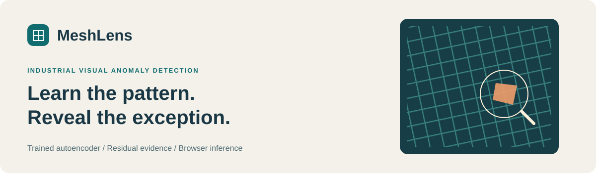
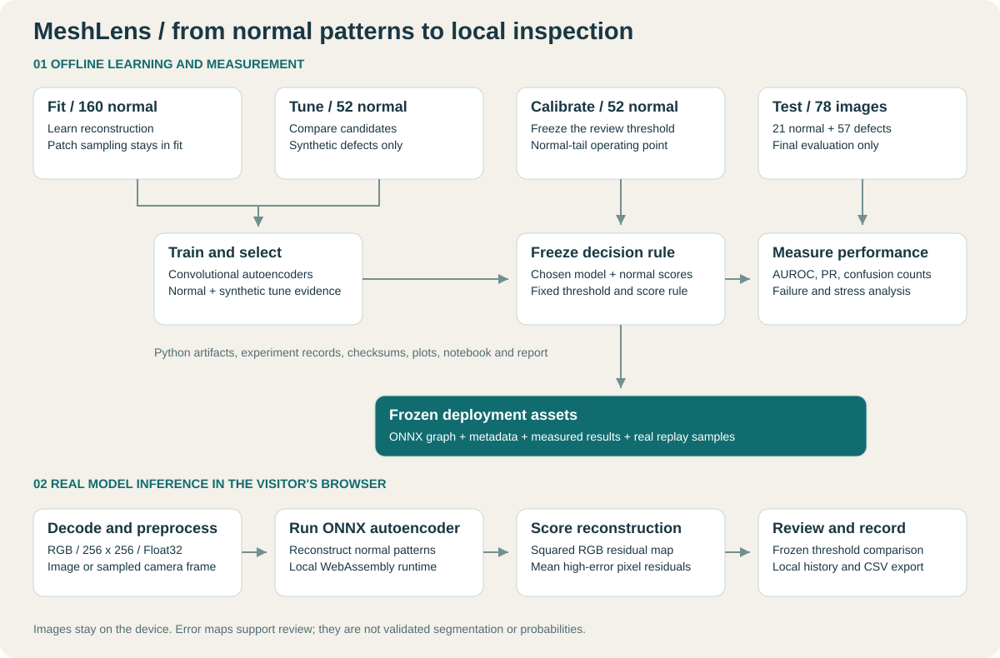
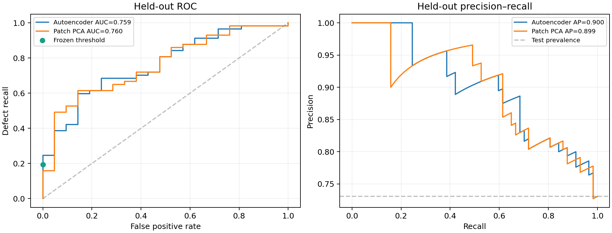

# MeshLens

**Industrial mesh inspection with a trained autoencoder and real inference in your browser.**

**Use this as an industrial inspection prototype for human review.** At the frozen operating
point it detected 11 of 57 benchmark defects and missed 46. It is unsuitable for automatic
acceptance, rejection, or production quality guarantees without substantial further development
and validation on the target line.

A repeated grid pattern makes small defects easy to overlook. MeshLens learns the normal
pattern from defect-free material, reconstructs a new image, and exposes where the
reconstruction disagrees with it. The result is a review signal with visible evidence.

[Private live preview](https://meshlens-inspection.vs8953.chatgpt.site) · [Run or deploy](docs/deployment.md) · [Technical report](reports/technical_report.pdf) ·
[Executed walkthrough](notebooks/01_meshlens_walkthrough.ipynb) · [Model card](docs/MODEL_CARD.md)
· [Workflow guide](docs/RUNBOOK.md) · [Project audit](reports/PROJECT_AUDIT.md)

## What you can try

- Inspect a bundled mesh example, a local PNG/JPEG/WebP image, or a sampled camera frame.
- Compare the input, trained-model reconstruction, and residual heatmap.
- See the anomaly score, frozen calibration threshold, model version, and inference time.
- Replay examples sequentially and export bounded browser-local history as CSV.
- Inspect measured evaluation results and versioned model/data metadata.

The static app executes the actual ONNX graph through ONNX Runtime Web. Images stay on
the device. History belongs to the current browser; it is not a shared production audit
trail. Camera access begins only after user action and browser permission.
Camera mode inspects one frame at a time, with a selectable 250, 1000 or 2500 ms wait after
each completed inspection (default 1000 ms). It is sampled live review, not full-video-FPS
processing. Model-call time excludes image decoding and other processing. Physical camera
hardware and production line throughput have not been validated.

## How it works



1. Learn normal patterns using a convolutional autoencoder trained from random initialization.
2. Compare candidates on reserved normal development images and fixed synthetic alterations.
3. Calibrate the review threshold using another normal-only partition.
4. Measure the frozen model on the official held-out real-defect test images.
5. Deploy the frozen ONNX graph with the same tensor and scoring contract.

The pixel residual is the mean squared RGB reconstruction difference. The image score
averages a frozen top fraction of residuals. A score strictly above the separately calibrated
threshold requests review. The score is not a defect probability, and the heatmap is not
validated segmentation. [Model architecture](reports/model-architecture.svg).

## Measured results

<!-- MESHLENS_MEASURED_RESULTS_START -->
| Frozen method | AUROC | Average precision | Precision | Defect recall | F1 |
|---|---:|---:|---:|---:|---:|
| Convolutional autoencoder | 0.7594 | 0.9005 | 100.00% | 19.30% | 32.35% |
| Patch PCA baseline | 0.7602 | 0.8987 | 100.00% | 8.77% | 16.13% |

At the frozen threshold, **11 of 57 defects** were flagged, **46 were missed**, and **0 of 21 normal images** were flagged. The stratified fixed-model bootstrap 95% AUROC interval is 0.6391-0.8655. It measures resampling uncertainty for this fixed model, not retraining or new-factory variation.

Development selected `denoising`, 8 latent channels, checkpoint epoch 26, and the largest 1% of pixel residuals. Separate normal calibration fixed the threshold at `0.02402208`.

Wilson 95% precision interval: 74.12%-100.00%; normal false-alarm interval: 0.00%-15.46%. Zero observed false alarms is not proof of zero population risk.

<!-- MESHLENS_MEASURED_RESULTS_END -->



Ranking and operating-point metrics answer different questions. Precision must be read
alongside defect recall and the actual confusion counts. Failures and distribution-shift
sensitivity remain visible in the technical report and model card.

## Dataset and experiment boundary

MVTec AD grid is an industrial mesh-like texture category. The acquisition script records
all source counts, per-image hashes, masks, and duplicate checks in the current provenance.
The deterministic source-image split uses 160 fit, 52 tune, and 52 calibration normal images;
the official 78-image test split contains 21 normal and 57 defective images.

| Role | Permitted use |
|---|---|
| Fit | Weight optimization and extraction of normal training patches |
| Tune | Checkpoint, candidate and score-rule comparison with fixed synthetic alterations |
| Calibration | Frozen normal-tail decision threshold |
| Official test | Final reported real-image evaluation after selection and calibration |

The source image is the split unit. Patches never cross roles. Real test labels and masks
do not train the network or select the threshold. Synthetic tune defects are development
proxies and are never counted as real held-out defects. See the [dataset card](docs/DATASET_CARD.md).

## Run the web app locally

With Node.js/npm installed, build from the extracted project root:

```bash
npm ci
npm run build
npm run serve
```

Open http://127.0.0.1:4173. The server binds to loopback by default. If Python is available,
an alternative local server is:

```bash
python -m http.server 8000 --bind 127.0.0.1 --directory dist
```

For the Python server, open http://127.0.0.1:8000. Wait for model ready and inspect a bundled example.
The Node-native static build copies existing trained artifacts; it does not retrain or download raw
training images. See the [deployment guide](docs/deployment.md) for hosted deployment.

## Reproduce training and evaluation

Use Python 3.12 on Linux x86_64 in an isolated environment. The exact Python locks were measured
on this platform; native Windows/macOS dependency installation is not a tested claim. Windows
users can run the static application with Node.js and use a Python 3.12 Linux/WSL environment
for model development; see the [workflow guide](docs/RUNBOOK.md).

```bash
python3.12 -m venv .venv
source .venv/bin/activate
python -m pip install -r requirements-dev.lock
python -m pip install --no-deps -e .
npm ci
python scripts/download_data.py
python scripts/train.py
python scripts/evaluate.py
python scripts/export_model.py
python -m pytest -q
npm test
python scripts/verify_wasm.py --full-test
python scripts/make_notebook.py
python scripts/make_report.py
```

Inspect a local image with the exported graph:

```bash
python scripts/predict.py artifacts/samples/bent-000.png --output tmp/inspection.json --evidence tmp/evidence
```

The notebook loads the shipped model and reports rather than rerunning training. The
source manifest, package locks, candidate records, epoch history, calibration scores,
per-image test predictions, export checks, and runtime checks retain the experiment evidence.
The release includes completed `candidate-*.pt` files. `train.py` validates and reuses matching
candidates, then recomputes development selection; an interrupted optimization resumes from
its matching `training-resume-*.pt` file. To optimize again from random initialization, first
move both sets of files out of `artifacts/` and retain a copy of the release for comparison.
`requirements-training-original.lock` records the historical training environment; the
default locks select the patched runtime. A frozen-checkpoint compatibility comparison
does not establish identical weights after retraining with a different runtime.

## Project layout

| Directory | Contents |
|---|---|
| `artifacts/` | Checkpoint, ONNX graph, metadata and tracked real examples |
| `src/meshlens/` | Autoencoder and runtime-independent data/scoring contracts |
| `scripts/` | Acquire, train, evaluate, export, predict, build and report commands |
| `web/` | Original responsive workspace and browser inference |
| `reports/` | Measured experiments, predictions, plots and technical PDF |
| `notebooks/` | Executed trained-model walkthrough and execution record |
| `data/` | Manifest and provenance; ignored raw acquisition and cache |
| `tests/` | Data, model, export and browser numerical regression checks |
| `docs/` | Model/data cards, architecture, deployment and Windows guides |

## Verification and limitations

<!-- MESHLENS_VERIFICATION_START -->
Source/model verification: passed; 145 Python tests, 145 passed, 0 failures, 0 errors and 0 skips.

Node.js browser-contract tests: 85 tests, 85 passed, 0 failures, 0 errors and 0 skipped.

Source-only checkout verification: passed; 145 Python tests, 144 passed, 0 failures, 0 errors and 1 skipped. The optional full raw-data audit is separate from mandatory tracked-model/example inference.

PyTorch/ONNX export check: 78 official test images, maximum tensor difference 2.98e-07, maximum score difference 4.29e-09, 0 changed decisions.

Actual ONNX Runtime Web WebAssembly under Node.js: passed; 78 shared canonical tensors, maximum score difference 3.01e-09, 0 changed decisions. Browser decoding, DOM interactions and physical cameras are outside this check.

Framework boundary diagnostic: PyTorch 2.9.0+cpu to 2.14.1+cpu on 130 calibration/test images. Strict decision parity failed; maximum score difference 3.52e-10. Changed decisions: calibration 1, official test 0. A calibration score exactly equal to the frozen threshold crosses it after a tiny floating-point change. Numerical tolerances are met, but exact decision equality is not. The threshold was not retuned. Browser/CLI inference use the frozen ONNX graph. No retraining is implied.

Named-scope dependency advisory scans: recommended runtime: passed, 36/36 packages, 0 findings; development: passed, 97/97 packages, 0 findings; historical original-training lock: 5 findings (provenance only, not the default install); npm: 0 findings. These scans are not security certification.
<!-- MESHLENS_VERIFICATION_END -->

A source-only test checkout must use tracked model/example assets rather than assume the
ignored raw dataset exists. The full raw-data audit is separate. Export checks compare the
trained checkpoint with ONNX; JavaScript checks and actual WebAssembly execution cover the
browser contract. A successful dependency scan is not a security certification.

The learned scope is controlled views of grid-like material. Lighting, scale, pose, blur,
material changes and camera movement can cause false alarms or missed defects. A curated
benchmark does not establish factory qualification, safety certification or production throughput.
The [project audit](reports/PROJECT_AUDIT.md) distinguishes fixes, observed passing checks,
open model limitations, and physical scenarios that have not been tested. No finite test suite
proves that every possible edge case is covered.

## License and authorship

Original code and documentation: **Kumar Waibhav Akshat** · **kwa.waibhav@gmail.com** · [MIT](LICENSE).

MVTec AD images, masks, bundled examples and dataset-derived material retain CC BY-NC-SA 4.0
terms. The code license does not grant commercial data rights. See the
[dataset card](docs/DATASET_CARD.md) and [third-party notices](THIRD_PARTY_NOTICES.md).

Use the [Windows PowerShell GitHub guide](docs/github-windows.md) to verify commit identity
and authenticated GitHub account before publishing the extracted source.
