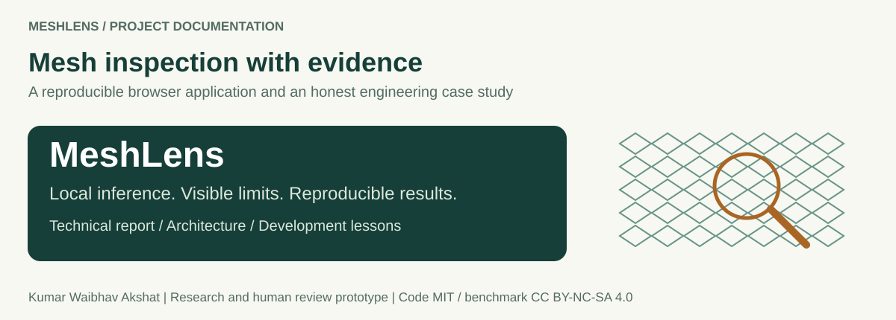

# MeshLens

**Browser-based mesh inspection with local inference and visible evidence.**

[](https://github.com/kumarwaibhav/MeshLens/actions/workflows/ci.yml)
[](LICENSE)
[Data license CC BY-NC-SA 4.0](docs/DATASET_CARD.md)

[Open live demo](https://mesh-lens.vercel.app) · [Read the project report](docs/report/MeshLens_Project_Report.pdf) · [Explore documentation](docs/README.md) · [Lessons learned](docs/LESSONS_LEARNED.md)

MeshLens examines a close-up of woven industrial mesh, finds regions that disagree with its repeating pattern, and returns **Review**, **Within calibrated range**, or **Input needs review**. It displays the score, threshold, model version, and supporting evidence.

The active decision comes from a normal-fitted texture detector. A separately trained **convolutional autoencoder** supplies reconstruction and residual views. It is an engineering and research prototype for human review; factory acceptance or rejection requires independent qualification.


*Current desktop application capture. Screenshots illustrate the workflow; they are not accuracy or universal device-compatibility evidence.*

## Inspect an image

1. Open the demo and wait for model readiness. Start with a guided example to understand the controls.
2. Compare **Original**, **Detector map**, **Reconstruction**, and **AE error map**. The texture detector supplies the decision; the AE views explain reconstruction.
3. Read the result beside its threshold and limitation. Download a JSON record or export browser-local history as CSV.
4. Upload a new photograph of comparable mesh, or explicitly permit camera sampling. Use the capture guidance below.

The 18 bundled examples and downloadable image kit replay an already measured MVTec benchmark. Their known labels help explain successes and failures. Replaying them supplies no new independent accuracy evidence. The detector map shows relative disagreement, not defect probability or validated segmentation.

<details>
<summary>View the inspection workspace and measured-results page</summary>


</details>

## Architecture


Python handles verification, development, calibration, evaluation, and offline inspection. Node.js builds the static release. The browser runs the active detector in a module worker and the separate AE through ONNX Runtime Web. Vercel serves the application and frozen assets; it does not receive inspection images for inference.

The active release is `meshlens-inspect-7665cb57f023`. The detector estimates lattice repeats, compares neighboring regions at two scales, normalizes against normal-fit statistics, and averages the largest 0.5% of responses. Its eight-decimal score requests review only when strictly above **1.01049636**. Opening the application or uploading a photograph does not train either model.

## Measured performance and limits

<!-- MESHLENS_INSPECTION_RESULTS_START -->
| Frozen pipeline | Defects flagged | Missed | Normal false alarms | AUROC |
|---|---:|---:|---:|---:|
| Active normal-lattice detector | **56/57 (98.25%)** | **1** | **4/21 (19.05%)** | **0.9958** |
| Historical reconstruction AE | 11/57 (19.30%) | 46 | 0/21 (0.00%) | 0.7594 |

All 78 original benchmark images produced scores. The active detector's Wilson 95% intervals are 90.71%-99.69% for recall and 7.67%-40.00% for the normal false-alarm rate.

**The declared release goal was not met.** Recall exceeded 90%, but normal false alarms exceeded the 5% limit. Reflected-border translation flagged **21/21 normal images**; brighter views flagged 6/21. The known missed glue image scores 0.97635626, below the frozen threshold despite a real defect. The threshold was not retuned after these observations.
<!-- MESHLENS_INSPECTION_RESULTS_END -->

These are known-benchmark reproducibility results. The recovered release repeats a previously selected algorithm whose official outcomes were already known. Original selection excluded test images from fitting, candidate choice, and calibration. A new representative target-line study is still required. See the [model card](docs/MODEL_CARD.md) and [complete evaluation](reports/inspection/evaluation.json) for counts, all six conditions, coverage, and uncertainty.

## Dataset and development

MVTec AD Grid contains **342 real photographs and 57 defect masks**. Defects include bent and broken wires, glue, metal contamination, and foreign thread. The 264 normal training sources are partitioned before development:

| Role | Sources | Use |
|---|---:|---|
| Fit | 160 normal | Normal reference fitting and AE training |
| Tune | 52 normal | Candidate comparison with fixed synthetic alterations |
| Calibration | 52 normal | Freeze the threshold |
| Official test | 21 normal + 57 defective | Measure the frozen pipeline |

The tune suite adds 260 seeded synthetic alterations to its 52 unchanged sources. Patches and derivatives stay with their source role. Synthetic development recall is separate from real-defect recall. [Dataset provenance and rights](docs/DATASET_CARD.md) explain the pinned archive, digests, masks, and reuse terms.

## Test with new data

Photograph similar woven mesh under stable lighting with a sharp, close-up view and comparable mesh scale. Use still PNG/JPEG/WebP files up to **12 MiB**, **4096 pixels per side**, and **16 megapixels**. Both sides must be at least **256 pixels**, with aspect ratio at most **1.5**. The whole suitable image is resized; there is no hidden crop to repair framing. Missing repetition or invalid inputs must produce input review rather than a numerical acceptance.

For independent evaluation, collect separate physical parts or sections, label them independently of model scores, and group repeated frames/crops by part. Follow the [field-validation guide](docs/FIELD_VALIDATION.md). Camera mode samples one frame at a time after permission; it does not claim video-rate inspection. History is local to the browser, exportable, and clearable, rather than an authenticated industrial audit store.

## Run locally

With Node.js 22 or newer:

```bash
git clone https://github.com/kumarwaibhav/MeshLens.git
cd MeshLens
npm ci
npm test
npm run build
npm run serve
```

Open the printed URL, normally `http://127.0.0.1:4173`. On Windows PowerShell, use `npm.cmd` if the `npm.ps1` shim is blocked. The build verifies shipped assets without retraining or downloading the dataset. An occupied port, Python setup, and deployment troubleshooting are covered in the [workflow guide](docs/RUNBOOK.md).

For lightweight offline inspection on Python 3.12:

```bash
python3.12 -m venv .venv-inspection
.venv-inspection/bin/python -m pip install -r requirements-inspection.lock
.venv-inspection/bin/python -m pip install --no-deps -e .
.venv-inspection/bin/python scripts/inspect_image.py /path/to/mesh.png --evidence inspection-output/run-1
```

The active Python path uses NumPy and Pillow. Choose a new evidence directory for each inspection. [Windows equivalents, CLI exits, and reproduction commands](docs/PROJECT_DOCUMENTATION.md#installation-and-operation) are documented separately from historical AE training.

## Engineering contribution

MeshLens combines frozen data roles, independently calibrated decisions, cross-runtime numerical checks, bounded asynchronous workflows, explicit inconclusive states, and reproducible deployment. These are useful engineering outcomes around an established anomaly-detection problem. The project does not establish a new state-of-the-art method or a commercially qualified inspection process. Its [retrospective](docs/LESSONS_LEARNED.md) records model weaknesses, deployment mistakes, documentation gaps, and the fixes that improved delivery.

The reference source release `5f11b39` passed both GitHub Actions jobs in [run 43376785899](https://github.com/kumarwaibhav/MeshLens/actions/runs/43376785899). Runtime checks reproduced Python/JavaScript decisions on all 78 official inputs and 18 gallery replays. Responsive CSS and prior accessibility work do not certify every physical device, browser, or assistive technology.

## Documentation

| Read | Purpose |
|---|---|
| [Project report PDF](docs/report/MeshLens_Project_Report.pdf) · [Editable Word report](docs/report/MeshLens_Project_Report.docx) | Branded architecture, evidence, UI, development history, and assessment |
| [Complete technical documentation](docs/PROJECT_DOCUMENTATION.md) | Algorithms, contracts, commands, reproduction, and operation |
| [Lessons learned](docs/LESSONS_LEARNED.md) · [Next project playbook](docs/NEXT_PROJECT_PLAYBOOK.md) | Failures, causes, corrective actions, and staged acceptance criteria |
| [Documentation index](docs/README.md) | Model/data cards, diagrams, runbooks, UI design, and field workflow |

## Ownership and licenses

Original code and documentation: **Kumar Waibhav Akshat**, [MIT](LICENSE). MVTec photographs, masks, examples, and dataset-derived material retain **CC BY-NC-SA 4.0** terms. The code license does not grant commercial dataset rights. Preserve [third-party notices](THIRD_PARTY_NOTICES.md) when sharing the project.
