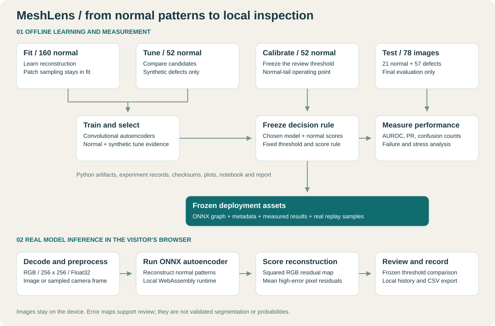

# MeshLens architecture

Python owns acquisition, model development, normal-only calibration, final evaluation and
export. A static web app loads the frozen ONNX graph and runs it in the visitor's browser.

## Boundaries

Fit 160 / tune 52 / calibration 52 contain only normal source images. The official test 78 remains
separate from weight optimization, candidate/checkpoint choice, score-rule selection and
threshold calibration. Source images are the split unit; patches never cross roles.

The browser decodes locally, resizes RGB to 256 x 256, normalizes Float32 values to `[0,1]`, and
arranges NCHW input. The graph returns reconstruction. Per-pixel mean squared RGB residuals
are aggregated using the frozen top-fraction rule. Review is requested only above the
separate normal-calibrated threshold. Equality remains within the learned range.

Images are not sent to a Python inference API. Bounded summary history lives in browser
storage, with explicit CSV export and clear controls. It is not an authenticated or shared
production audit database. A fixed model and its metadata are versioned static assets;
website startup never retrains the network.

The reconstruction/error views explain model behavior. They do not establish a defect
probability, validated segmentation or a physical-cause diagnosis. Deployment needs stable
lighting, scale and view, followed by validation on representative camera data.
