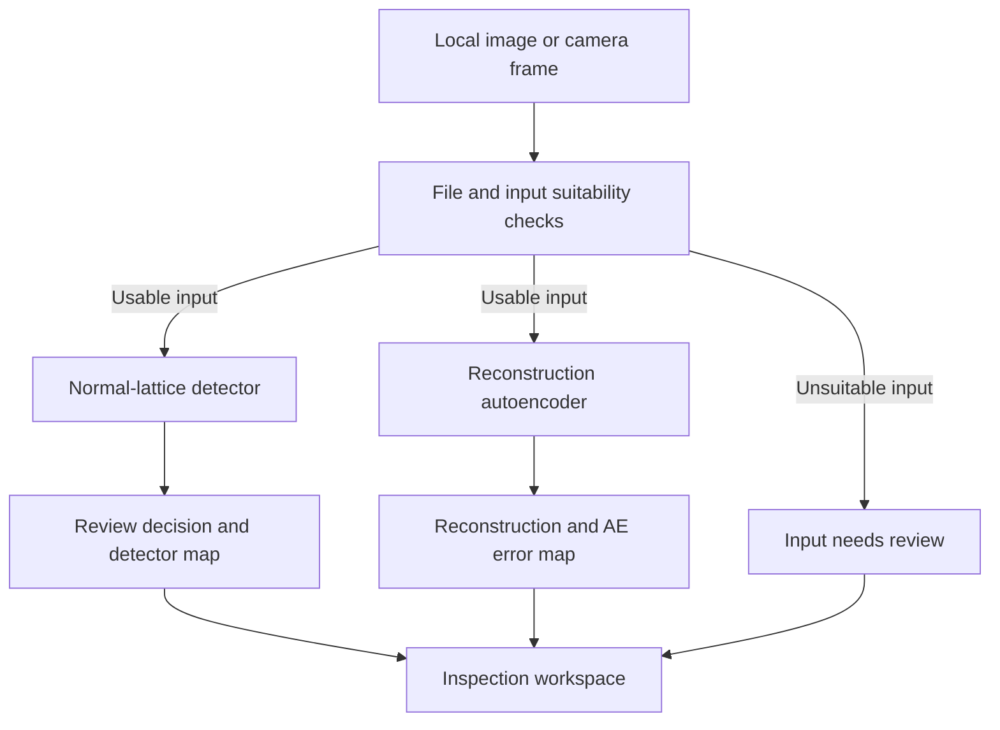

# MeshLens architecture

The active inspection detector and original reconstruction autoencoder have separate outputs.
Both execute on the visitor's device. Python handles data verification, development,
calibration, frozen evaluation and offline inspection. The static host serves artifacts.

The texture detector uses `area-rgb8-v1` to create a 256×256 canonical input, estimates mesh
repeat directions, compares neighboring regions and aggregates the largest 0.5% of normalized
responses. Its rounded score is compared strictly with the frozen metadata threshold.
A tie stays within range. Its relative map supports inspection; intensity does not represent
defect probability or validated pixel segmentation.

The historical AE uses its own 256×256 tensor/reconstruction contract. Its RGB squared
reconstruction residual is shown in the **AE error map**. That residual does not set the
active texture score. The original [AE system diagram](../reports/architecture.svg) and
[AE model card](AUTOENCODER_MODEL_CARD.md) retain the earlier experiment.

## Model and data boundaries

The source image is the partition unit: 160 normal fit, 52 tune and 52 calibration images.
All derived patches and synthetic images stay in their source role. The 52-source tune suite
contains 52 unchanged images and 260 seeded alterations for development. A frozen selection
rule compares candidates before the separate 52-image normal calibration. The official
21-normal/57-defect benchmark is evaluated after release freeze. It had already measured
the historical AE and selected texture detector. This recovery repeats the previously
selected architecture and cutoff without retuning. Its known benchmark outcomes provide
reproducibility evidence and supply no new independent target-line cohort.

`artifacts/inspection/detector.json` describes the active runtime, input policy, threshold,
model file/hash and calibration. The frozen record additionally pins protocol, selection,
source manifest and implementation bytes. The build validates those relationships and
measured support counts before packaging browser assets. Browser load failures and unsuitable
inputs block numeric acceptance decisions. Offline `InspectionDetector` uses the same
scored/inconclusive policy through `scripts/inspect_image.py`.

## Application and operation boundaries

Inference does not send images to a Python API. Camera access begins after user action and
permission. Serial sampling waits after each completed frame; there is no video-rate inference
queue. Bounded browser-local history supports export and clear/recovery, with version and
threshold provenance. It is device-specific and provides no authenticated shared audit store.

The reproduced known benchmark scored 78/78 images and flagged 56/57 defects with
4/21 normal false alarms. Its declared 5% false-alarm goal failed, and shifted-view stress
flagged every clean image. See the [active model card](MODEL_CARD.md) for counts, uncertainty
and the reproduced release's evidence. Target-line accuracy, device timing, camera optics,
process coverage and operating acceptance require the [independent field workflow](FIELD_VALIDATION.md).
