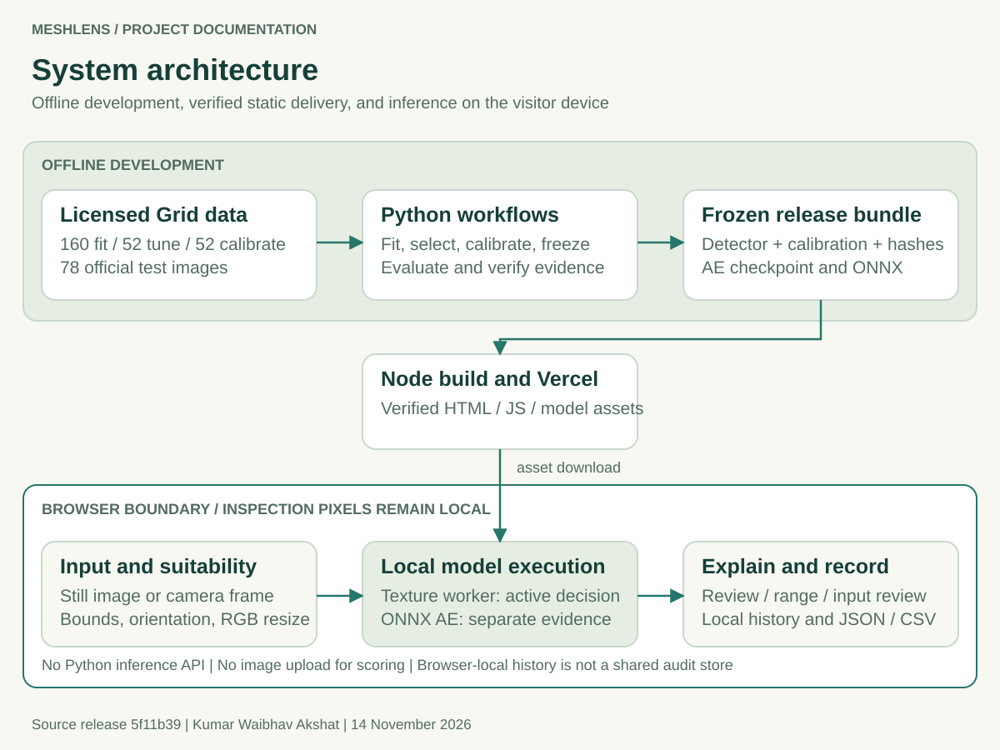
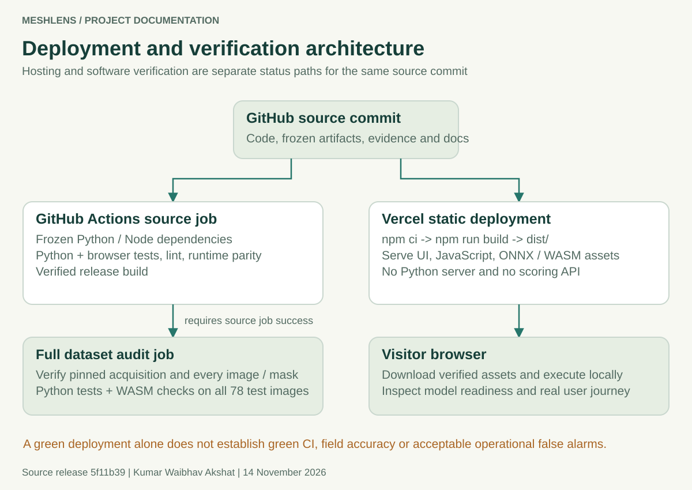
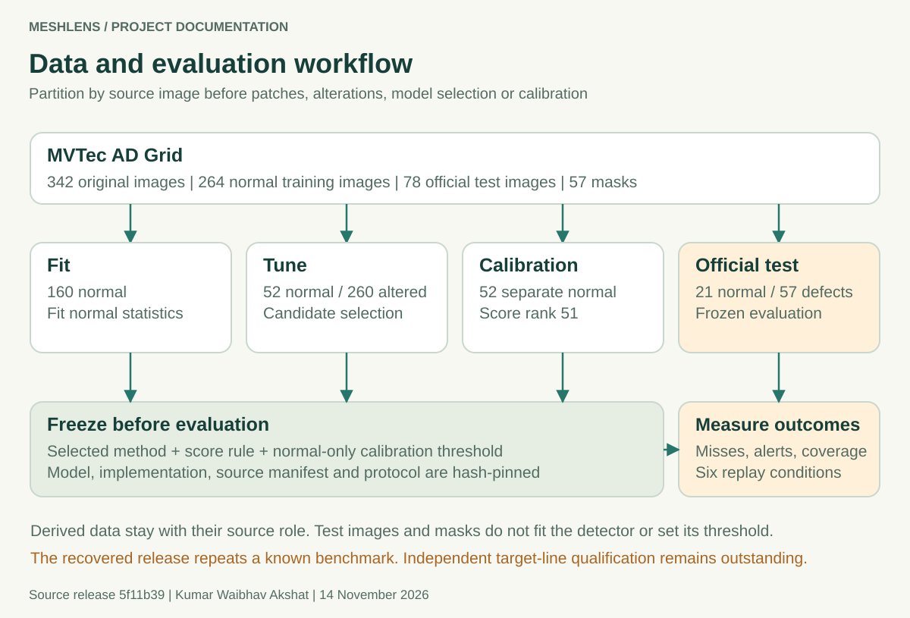
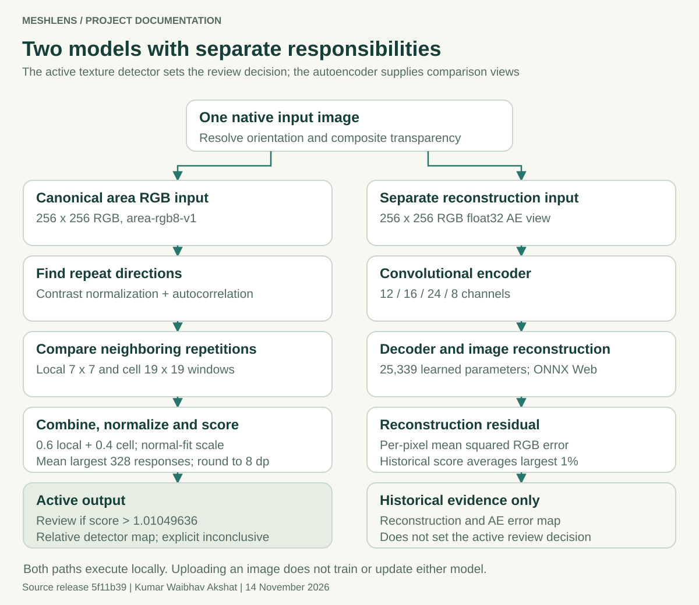
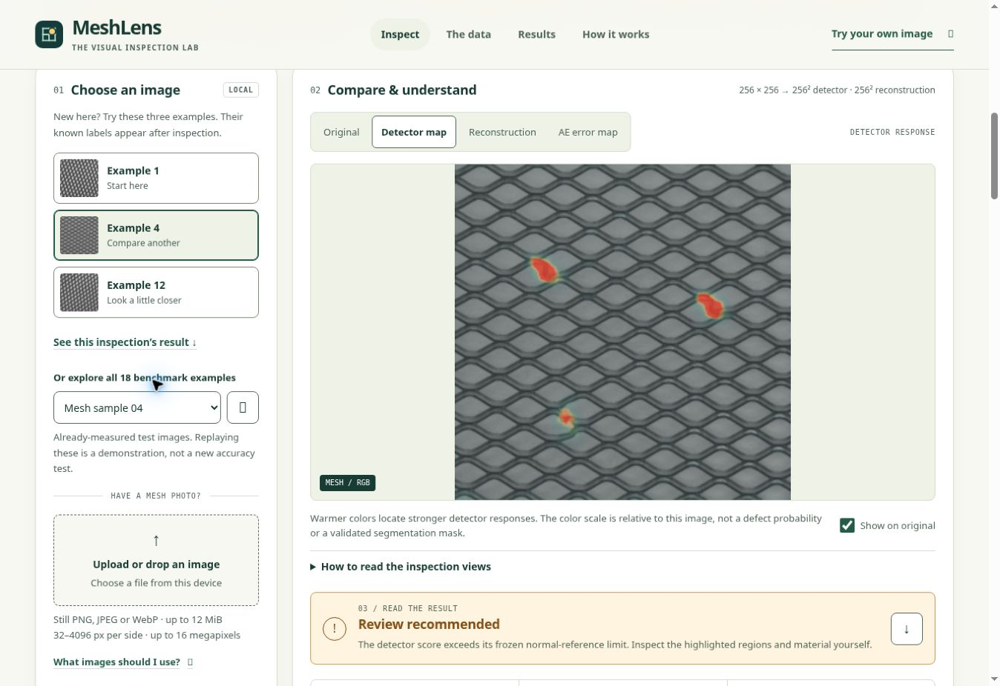
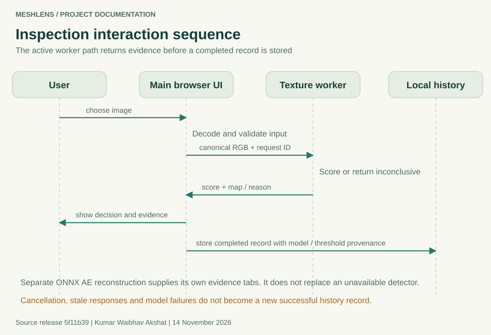

# MeshLens Project Documentation

**Author:** Kumar Waibhav Akshat

**Documentation date:** 14 November 2026

**Reference source release:** [`5f11b39`](https://github.com/kumarwaibhav/MeshLens/commit/5f11b39fbd989e2b4f6359dc75cda062daf8b9ba)

**Active detector:** `meshlens-inspect-7665cb57f023`

MeshLens is a browser-based inspection prototype for close-up photographs of woven industrial mesh. It finds regions that disagree with the surrounding repeating structure, requests human review when a frozen score limit is exceeded, and displays the supporting evidence. The application also retains a trained convolutional autoencoder so users can compare the input with a reconstruction and its residual map.

The engineering outcome is a reproducible inspection workflow with explicit failure states, frozen artifacts, browser-local processing, and measured limitations. The current detector reproduces 56 detections among 57 defective benchmark images, but flags 4 of 21 normal images. It fails the declared 5% normal false-alarm goal and has substantial translation sensitivity. This release supports research and human review; independent factory qualification remains outstanding.

## Documentation map

- [System and deployment](#system-and-deployment)
- [Dataset and partition controls](#dataset-and-partition-controls)
- [Active detector and scoring](#active-detector-and-scoring)
- [Historical autoencoder](#historical-autoencoder)
- [Development and release protocol](#development-and-release-protocol)
- [Measured results and uncertainty](#measured-results-and-uncertainty)
- [Application workflows and interfaces](#application-workflows-and-interfaces)
- [Installation and operation](#installation-and-operation)
- [Reproduction and verification](#reproduction-and-verification)
- [Security and operational limits](#security-and-operational-limits)
- [Independent field qualification](#independent-field-qualification)

For detailed incident analysis and improvements to the next project, read [Lessons Learned](LESSONS_LEARNED.md). The [active model card](MODEL_CARD.md), [dataset card](DATASET_CARD.md), [workflow guide](RUNBOOK.md), and [field validation guide](FIELD_VALIDATION.md) remain the detailed references for their respective scopes.

## System and deployment



Python is used for dataset verification, development, fitting, calibration, evaluation, and offline inspection. Node.js builds the static website. Vercel serves HTML, CSS, JavaScript, metadata, model files, and WebAssembly assets. The visitor's browser executes the active detector in a module worker and the separate autoencoder through ONNX Runtime Web. There is no Python inference API in the deployed architecture.

This separation makes the application inexpensive to host and keeps inspection pixels on the visitor's device during inference. It also means results depend on the visitor's browser, CPU, memory, native decoder, and camera. A host deployment succeeding does not establish an acceptable detector false-alarm rate, universal device support, or production throughput.

| Source location | Responsibility |
|---|---|
| [`src/meshlens/inspection_input.py`](../src/meshlens/inspection_input.py), [`web/inspection_input.js`](../web/inspection_input.js) | Canonical integer RGB preprocessing |
| [`src/meshlens/texture_detector.py`](../src/meshlens/texture_detector.py), [`web/texture_detector.js`](../web/texture_detector.js) | Active texture analysis and score |
| [`src/meshlens/inspection.py`](../src/meshlens/inspection.py) | Frozen bundle validation and offline scored/inconclusive result contract |
| [`web/detector.js`](../web/detector.js), [`web/texture_worker.js`](../web/texture_worker.js) | Browser detector adapter, worker lifecycle, and bounded requests |
| [`web/app.js`](../web/app.js) | Input selection, evidence, camera, replay, history, and export |
| [`src/meshlens/model.py`](../src/meshlens/model.py), [`web/inference.js`](../web/inference.js) | Historical AE model and reconstruction residual math |
| [`scripts/inspection_release.mjs`](../scripts/inspection_release.mjs) | Active release integrity and evaluation consistency checks |
| [`scripts/build_web.mjs`](../scripts/build_web.mjs) | Verified staged build into `dist/` |
| [`scripts/serve_web.mjs`](../scripts/serve_web.mjs) | Loopback-only local static server |



The hosting settings in [`vercel.json`](../vercel.json) select `npm ci`, `npm run build`, and `dist`. A clean build verifies frozen relationships before replacing the previous release. Missing or inconsistent detector assets must stop the build or block inspection; the historical AE is not a fallback decision model. The generated release manifest records the deployed asset digests. SHA256 checks detect inconsistent bytes but do not authenticate their author as a digital signature would.

## Dataset and partition controls



The benchmark is the **Grid category of MVTec AD**. It contains 342 original 1024 by 1024 photographs, including 264 normal training images and 78 official test images. The test set has 21 normal images and 57 defects across bent, broken, glue, metal-contamination, and thread groups. Fifty-seven masks provide defect-region ground truth. MeshLens reports image-level detection; the masks do not establish that its displayed response map is a validated segmentation output.

| Partition | Source images | Purpose |
|---|---:|---|
| Fit | 160 normal | Fit normal reference statistics and train AE candidates |
| Tune | 52 normal | Compare candidate methods using normal images and fixed synthetic alterations |
| Calibration | 52 normal | Set the selected detector's operating threshold |
| Official test | 21 normal and 57 defective | Evaluate the complete frozen pipeline |

The source image is the partition unit. Patches and altered versions inherit their source role, preventing a derived image from crossing fitting, tuning, and calibration boundaries. The upgrade's tune suite contains 52 unchanged images plus 260 seeded alterations, one for each of five alteration families per tune source. Those families are bend, gap, fibre, glue, and contamination. Synthetic development performance is a proxy, reported separately from real-defect benchmark results.

[`data/manifest.csv`](../data/manifest.csv) records source paths, roles, labels, defect groups, SHA256 digests, and mask paths. [`data/mask_checksums.json`](../data/mask_checksums.json) records mask digests. [`data/provenance.json`](../data/provenance.json) pins split seed 42, the source archive hash, and mirror revision `dc1c313de9de1be8e41fe6818dc43caac8601efa`. The acquisition audit is against that pinned public mirror; it does not claim a separate byte comparison with an official download.

The repository tracks 401 raw files: 342 images, 57 masks, and two source license/readme files. The downloader verifies the archive, extraction paths, decoded images, expected counts, and duplicate image hashes. It stages replacements and requires an explicit repair for partial or corrupt data. Expected hashes must not be edited to make damaged inputs pass.

The data, masks, examples, and derived material retain **CC BY-NC-SA 4.0** terms. MeshLens code and original documentation use MIT. Code ownership does not grant commercial rights to the benchmark. Preserve [`THIRD_PARTY_NOTICES.md`](../THIRD_PARTY_NOTICES.md) and consult the [dataset card](DATASET_CARD.md) before redistribution or commercial planning.

## Active detector and scoring



The active method is a normal-fitted, repeat-based texture detector, `normal-lattice-v1`. It has no pretrained neural weights. Its small JSON artifact records the selected variant, normal-fit scale, preprocessing contract, score aggregation, and threshold. Calling the application does not train or adapt this artifact.

### Input preparation

The still-image container must be PNG, JPEG, or WebP, no larger than 12 MiB. Structural bounds are 32 to 4096 pixels per side and at most 16 megapixels. The detector's additional suitability policy requires both sides to be at least 256 pixels and the longest-to-shortest-side ratio to be no greater than 1.5. Animated and malformed inputs are rejected. Adequate dimensions do not prove that an arbitrary image belongs to the intended material domain.

The pipeline resolves orientation, composites transparency over white, and resizes the entire suitable image to 256 by 256 RGB using `area-rgb8-v1`. The versioned filter uses integer pixel overlaps and fixed rounding. It does not silently crop an unsuitable photograph. Python and JavaScript agree on the resulting bytes when given identical decoded pixels; native codec decoding is a separate verification boundary.

### Texture analysis

The detector converts canonical RGB to channel-mean grayscale. It smooths local detail, subtracts a larger neighborhood mean, and normalizes local contrast. Autocorrelation estimates repeated lattice directions independently for each image. The method selects up to three independent directions and their opposites; at least two usable directions are required to score.

Neighboring repetitions are compared with small translation tolerance. Local and cell-scale windows use radii 3 and 9, corresponding to nominal 7 by 7 and 19 by 19 regions. For each scale, evidence uses the two best available neighboring matches. The selected `joint` map combines median-normalized local and cell responses with weights 0.6 and 0.4.

The response is divided by the fitted normal reference scale, `0.47045176621031776`. The image score is the mean of the largest **0.5%** of map values: `ceil(256 × 256 × 0.005) = 328` pixels. The score is rounded half-up to eight decimal places, then compared with the threshold **1.01049636**.

```text
score > 1.01049636       Review
score <= 1.01049636      Within calibrated range
unusable input/model    Input needs review or blocked inspection
```

This score is an unbounded measure of pattern disagreement, not a defect probability. The displayed map is relative evidence. Its color intensity is not a physical defect-size estimate or calibrated pixel confidence.

### Calibration and frozen identity

Architecture and score-rule selection precede the separate 52-normal-image calibration. With alpha 0.05, the threshold is sorted rank `ceil((52 + 1) × 0.95) = 51`. Equality remains within range. The normal-tail interpretation assumes exchangeability; a different camera, material, or viewpoint can violate that assumption.

The active model file is 1,261 bytes with SHA256 `7665cb57f02315c29a51209686a34b8a2e872f447ff31dac359c81d5c3fae5c1`. The pre-evaluation recovery freeze is `84b80e2b170f97ef5b432f78e210f260bbe687b72484e648661a21719daf9e23`. [`reports/inspection/frozen_configuration.json`](../reports/inspection/frozen_configuration.json) binds model, metadata, calibration, protocol, selection, source manifest, and four Python/JavaScript numerical source files.

## Historical autoencoder

The original convolutional AE remains available for reconstruction and historical comparison. Its encoder channels are `3 → 12 → 16 → 24 → 8`; the decoder reverses these stages to three RGB channels. The selected network has 25,339 parameters, LeakyReLU hidden activations, a linear bottleneck, sigmoid output, and reflect-padding followed by cropping. It was trained from random initialization on normal 64 by 64 patches, using Gaussian input noise with standard deviation 0.035. The selected checkpoint is epoch 26.

Its independent historical score averages the highest 1% of squared RGB reconstruction residuals, with threshold `0.0240220837`. At that operating point it flagged 11 of 57 defects and missed 46. The active interface therefore uses the texture detector for its decision and identifies the AE reconstruction/error views separately. A visually convincing reconstruction is not evidence that the input is defect-free.

The [`AUTOENCODER_MODEL_CARD.md`](AUTOENCODER_MODEL_CARD.md), [`artifacts/model.onnx`](../artifacts/model.onnx), original reports, and [executed notebook](../notebooks/01_meshlens_walkthrough.ipynb) preserve this experiment. `scripts/predict.py` runs the historical AE; `scripts/inspect_image.py` runs the active detector. These commands and their metrics must not be interchanged.

## Development and release protocol

Development proceeds through acquisition verification, normal-source partitioning, tune-suite generation, candidate comparison, normal-only calibration, release freeze, evaluation, runtime comparison, and packaging. The texture experiment compares five variants with three tail fractions, giving 15 fixed combinations. The recorded selection maximizes macro recall across synthetic families while allowing at most two clean tune alerts. The selected synthetic macro recall is 72.31% with 2/52 clean tune alerts; this is not real-defect test recall.

The original selection excluded official test images, labels, and masks from fitting, candidate choice, and calibration. The recovered release repeats the already selected method and cutoff after its benchmark outcomes were known. Its release protocol explicitly sets `benchmark_reuse: true` and `new_blind_validation: false`. Recovery supports reproducibility, not a new independent accuracy claim. No threshold adjustment was made to improve the known test result.

Evaluation retains a record for every image and declared condition. Inconclusive defects remain misses in recall; inconclusive normal inputs are not counted as correct clean decisions. Coverage and AUROC support are reported explicitly. Derived stress images reuse physical sources and cannot be counted as new independent parts.

## Measured results and uncertainty

| Frozen pipeline | Defects detected | Missed defects | Normal false alarms | AUROC |
|---|---:|---:|---:|---:|
| Active normal-lattice detector | 56/57 | 1 | 4/21 | 0.9958 |
| Historical reconstruction AE | 11/57 | 46 | 0/21 | 0.7594 |

For the active detector, recall is 98.25%, precision 93.33%, accuracy 93.59%, F1 95.73%, and coverage 78/78. The confusion counts are 56 true positives, one false negative, 17 true negatives, and four false positives. The missed glue image `test/glue/008.png` scores 0.97635626, below the frozen threshold. The normal files `007.png`, `011.png`, `018.png`, and `019.png` were falsely flagged.

The Wilson 95% interval is 90.71% to 99.69% for recall and 7.67% to 40.00% for the normal false-alarm rate. These intervals describe finite-count uncertainty for this fixed benchmark. They do not cover unknown process variation, retraining variation, or all deployment strata.

| Declared condition | Defects flagged / 57 | Clean alerts / 21 |
|---|---:|---:|
| Original | 56 | 4 |
| Brightness 70% | 56 | 2 |
| Brightness 130% | 56 | 6 |
| Reflected-border translation 8 by 4 pixels at 256 reference | 57 | 21 |
| Gaussian blur sigma 0.8 at 256 reference | 56 | 0 |
| JPEG quality 75 | 56 | 4 |

Every condition scored all 78 images. Translation produced 100% clean alerts and AUROC 0.5455, exposing a significant viewpoint/registration weakness. The declared release goal required recall at least 90%, false alarms at most 5%, and complete coverage. The original false-alarm rate of 19.05% fails that goal. Read [`evaluation.json`](../reports/inspection/evaluation.json) with its [raw frozen records](../reports/inspection/independent_evaluation.json), rather than selecting only favorable metrics.

## Application workflows and interfaces



The visitor starts with a guided example, a local still image, or an explicitly permitted camera frame. After model readiness and input checks, the application runs an inspection and displays its decision, score, threshold, model identity, and explanatory evidence. Known benchmark labels are for comparison after inference and are not detector inputs. The 18-image gallery and downloadable kit replay previously measured benchmark images.

Original, Detector map, Reconstruction, and AE error map are separate evidence views. History retains up to 100 completed records in local storage and displays the most recent five. JSON/CSV export preserves inspection provenance. Clear-history recovery is available within the UI. History is specific to the current browser and origin; it is not a shared authenticated or tamper-proof audit database.

The responsive rules in [`web/styles.css`](../web/styles.css) adjust at 1100, 820, and 600 CSS pixels, with an additional wide-screen rule at 1600 pixels. At 820 pixels the inspection grid becomes one column; at 600 pixels navigation wraps and score cards stack. These are implementation specifications. The current desktop screenshots do not establish mobile, physical-device, or complete accessibility test coverage.

Camera mode waits for user action and browser permission on HTTPS or localhost. It handles one frame at a time, then waits 250, 1000, or 2500 ms, with a 1000 ms default. Stop, page hiding, and ended tracks release sampling resources. Replay is finite and sequential. Input epochs and worker lifecycle controls prevent a stale asynchronous result from replacing a newer selection. These software controls do not establish full-video-frame-rate processing or camera-to-decision deadlines.



The offline `InspectionResult` contract contains `status`, `reason`, `message`, model and metadata digests, source digest, threshold, score, `is_anomaly`, decision, input size, and timing. `status` is `scored` or `inconclusive`; a failed input must not be translated into a normal acceptance. The numerical arrays are evidence objects, excluded from the JSON representation. Exact fields and validation reside in [`inspection.py`](../src/meshlens/inspection.py).

## Installation and operation

### Static web application

Use Node.js 22 or newer. From the repository root:

```powershell
npm.cmd ci
npm.cmd test
npm.cmd run build
npm.cmd run serve
```

On Linux/macOS, use `npm` instead of `npm.cmd`. Open the printed local address, normally `http://127.0.0.1:4173`, and keep the terminal running. The build uses shipped artifacts; it does not fit a model or fetch raw training data. Opening the site through `file://` is not the supported serving path.

If 4173 is occupied, request an available port:

```powershell
node --input-type=module -e "import {startServer} from './scripts/serve_web.mjs'; const server = await startServer({port:0}); console.log('http://127.0.0.1:' + server.address().port)"
```

### Minimal offline detector

Python packaging requires 3.12. The active path needs only the pinned NumPy and Pillow packages plus the local project:

```powershell
py -3.12 -m venv .venv-inspection
.\.venv-inspection\Scripts\python.exe -m pip install -r requirements-inspection.lock
.\.venv-inspection\Scripts\python.exe -m pip install --no-deps -e .
.\.venv-inspection\Scripts\python.exe scripts/inspect_image.py "C:\path\to\mesh-photo.png" --evidence inspection-output/run-1
```

`--bundle` selects another trusted complete release. `--output` adds a separate new JSON file. `--evidence` creates canonical input, relative anomaly map, and result JSON for a scored result. Choose a new output name each time; existing outputs and frozen project paths are protected. Exit 0 means a scored result, 1 means inconclusive, and 2 means invalid arguments or output failure. Linux/macOS uses `.venv-inspection/bin/python`. The pinned Python closures were observed on Linux x86_64; native platform compatibility is a separate check.

## Reproduction and verification

Use a separate project copy before regenerating models or evidence. First verify the acquisition:

```bash
.venv-inspection/bin/python scripts/download_data.py --verify-only
.venv-inspection/bin/python scripts/freeze_inspection.py --check
```

When data are absent, omit `--verify-only` to acquire the pinned archive. Use `--repair` explicitly for a damaged acquisition. Recreate the selected texture development and calibration outputs outside the delivered release:

```bash
.venv-inspection/bin/python scripts/make_development_suite.py --output ../meshlens-reproduction/development
.venv-inspection/bin/python scripts/fit_texture_detector.py --development ../meshlens-reproduction/development/manifest.csv --output-dir ../meshlens-reproduction/texture
.venv-inspection/bin/python scripts/fit_texture_detector.py --frozen-candidate ../meshlens-reproduction/texture/frozen-candidate.json --output-dir ../meshlens-reproduction/calibration
```

Compare regenerated artifacts with the supplied texture evidence before any packaging. `freeze_inspection.py` is specific to the recorded selected method and rejects conflicting existing bytes. Changing an algorithm requires a separately versioned development, calibration, and release protocol; overwriting expected hashes is not validation.

To repeat the supplied frozen evaluation, retain and pass its pre-evaluation digest:

```bash
.venv-inspection/bin/python scripts/evaluate_inspection.py --freeze-sha256 84b80e2b170f97ef5b432f78e210f260bbe687b72484e648661a21719daf9e23
.venv-inspection/bin/python scripts/export_inspection_release.py
.venv-inspection/bin/python scripts/verify_inspection_runtime.py --full-test --freeze-sha256 84b80e2b170f97ef5b432f78e210f260bbe687b72484e648661a21719daf9e23
```

Historical AE training uses a full Python 3.12 development environment, not the two-package inspection lock:

```bash
python3.12 -m venv .venv-dev
.venv-dev/bin/python -m pip install -r requirements-dev.lock
.venv-dev/bin/python -m pip install --no-deps -e .
.venv-dev/bin/python scripts/train.py --epochs 26
.venv-dev/bin/python scripts/evaluate.py
.venv-dev/bin/python scripts/export_model.py
```

Matching `candidate-*.pt` files are reused and compatible `training-resume-*.pt` files resume interrupted runs. To train afresh, retain and move those checkpoint families out of `artifacts/` in the reproduction copy first. A fresh fit, altered framework, or changed hardware can change results. See [RUNBOOK.md](RUNBOOK.md) for report/notebook regeneration and the original training environment's role.

For the complete software checks, install `requirements-dev.lock`, then run:

```bash
python -m pip check
python scripts/verify_project.py
python -m ruff check src scripts tests
PYTHONPATH=src python scripts/verify_wasm.py --full-test
python scripts/verify_inspection_runtime.py
npm run build
```

The verification runner records current Python and Node JUnit evidence, replaces stale success before execution, preserves timeout output, terminates check process trees, and fails incomplete evidence. The process-reaping regression in release `5f11b39` handles both a stopped zombie and a fully reaped Linux child while still rejecting a running descendant.

GitHub Actions has separate source/model and full-data jobs. The full-data job depends on successful source tests and runs for pushes to `main`, or explicit full-data manual dispatch. Vercel deployment is a separate status. Both jobs passed for reference release `5f11b39` in [run 43376785899](https://github.com/kumarwaibhav/MeshLens/actions/runs/43376785899). A new documentation push creates a new run whose result must be inspected independently.

## Security and operational limits

Release controls include bounded files and tensors, archive traversal/link rejection, strict JSON and artifact contracts, stale-input cancellation, worker request timeouts, safe text rendering, formula-neutralized CSV cells, and local-server path checks. These controls cover defined failure cases; they do not prove that all possible attacks or platform failures have been eliminated.

The [13 November dependency review](../reports/inspection/security-review.json) records zero known findings for npm, the two-package active Python runtime, and the audited development additions. The training scope explicitly skips the CPU-specific Torch build because the advisory service could not audit that package identity. The original training environment is retained for provenance rather than recommended installation. Advisory results are dated, scoped evidence, not a penetration test or an absence-of-vulnerabilities guarantee.

Responsive layouts, keyboard interactions, visible focus, error explanations, and the [prior accessibility review](design/ACCESSIBILITY_REVIEW.md) provide a basis for testing. They do not certify all screen sizes, native devices, screen readers, cameras, or browser versions. Repeat native-device, zoom, keyboard, and assistive-technology checks for the intended deployment. Model/runtime parity checks compare shared canonical pixels and numerical outputs; they do not cover every native image decoder or physical capture path.

## Independent field qualification

The next operational step requires independently labeled physical parts from the intended line. Freeze the collection scope, one-record-per-part roster, labels, artifact, threshold, scoring records, and acceptance criteria before evaluating. Repeated frames, crops, synthetic alterations, and benchmark replays must not inflate sample counts. Hash exclusions detect identical bytes; collection records must still preserve physical-part lineage.

[`scripts/qualify_field.py`](../scripts/qualify_field.py) validates evidence against the chosen protocol. It checks minimum clean/defect counts, per-class coverage, the recall lower Wilson bound, and the clean-review upper Wilson bound. Missing or inconclusive defective parts remain misses; clean review includes alerts and inconclusive results. An example invocation is:

```powershell
python scripts/qualify_field.py --cohort-manifest field/cohort.csv --records field/scores.csv --provenance field/run.json --model-artifact artifacts/inspection/detector-model.json --model-metadata artifacts/inspection/detector.json --report reports/field-qualification-run-1.json
```

The [field guide](FIELD_VALIDATION.md) defines the required schemas and explains the configurable example limits. Exit 0 means all configured checks pass, 1 means valid evidence fails a check, and 2 means invalid evidence or output failure. A passing result applies only to that evidence and capture scope. Camera hardware, material changes, motion, lighting, processing deadlines, reviewer capacity, and long-duration drift still need measured acceptance criteria and requalification rules.

MeshLens demonstrates complete engineering around a constrained inspection problem. Its practical next use is controlled experimentation and human review, with the unresolved false alarms and view sensitivity visible beside the measured improvements.
