# MeshLens Project Report

**Author:** Kumar Waibhav Akshat

**Date:** 14 November 2026

**Reference source:** `5f11b39fbd989e2b4f6359dc75cda062daf8b9ba`

[PDF edition](report/MeshLens_Project_Report.pdf) · [Editable Word edition](report/MeshLens_Project_Report.docx) · [Technical manual](PROJECT_DOCUMENTATION.md) · [Documentation index](README.md)

MeshLens is a browser-based engineering prototype for human review of woven mesh. Its active detector reproduces 56/57 defect alerts with 4/21 normal false alarms. The false-alarm goal remains unmet and independent factory qualification is outstanding.

## 01 Project purpose and contribution

MeshLens supports a human who needs to inspect a close-up photograph of woven industrial mesh. The application compares repeated patterns, highlights unusual disagreement and explains why an image was sent for review. The intended interaction is a second inspection aid, with the material and final judgment remaining with the operator.

### The delivered system

A static web application runs a normal-lattice texture detector in a browser worker. A trained convolutional autoencoder runs separately through ONNX Runtime Web and supplies reconstruction views. Python supports development, calibration, evaluation and offline inspection. The repository includes the Grid data, frozen artifacts, tests and operating guides.

| User sees | Meaning |
|---|---|
| Review | The active detector score is above its frozen limit. Inspect the material. |
| Within calibrated range | The score is at or below the limit. Defects may still be missed. |
| Input needs review | Input or model conditions do not support a numeric inspection decision. |

### Assessment of originality

Normal-only anomaly detection and reconstruction-based inspection are established ideas. This project does not demonstrate a new state-of-the-art research method. Its defensible contribution is the engineering: frozen data roles, deterministic preprocessing, cross-runtime agreement, controlled asynchronous execution, clear failure states and transparent limits.

For the next project, establish a real user need, a measurable gap in existing solutions and access to representative data before committing to an application or a preferred model family. A distinctive name and an attractive interface do not supply that evidence.

Read alongside docs/LESSONS_LEARNED.md and docs/NEXT_PROJECT_PLAYBOOK.md.

## 02 Development history

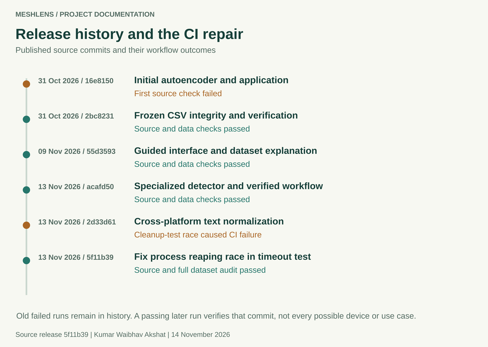

Published commits and their recorded workflow outcomes. Historical failures remain visible after a later fix passes.

The project began as an autoencoder inspection experiment. Guided onboarding and dataset explanations addressed confusion in the first interface. A specialized texture detector subsequently improved the recorded benchmark recall while retaining the AE as separate visual evidence.

The last repair, 5f11b39, corrected a process-cleanup test race. The source and full research-data jobs passed in GitHub run 43376785899. Public repository state was checked again on 14 November 2026: six commits, six workflow runs and no repository issues were returned. This documentation update will have its own commit and CI outcome.

## 03 System architecture

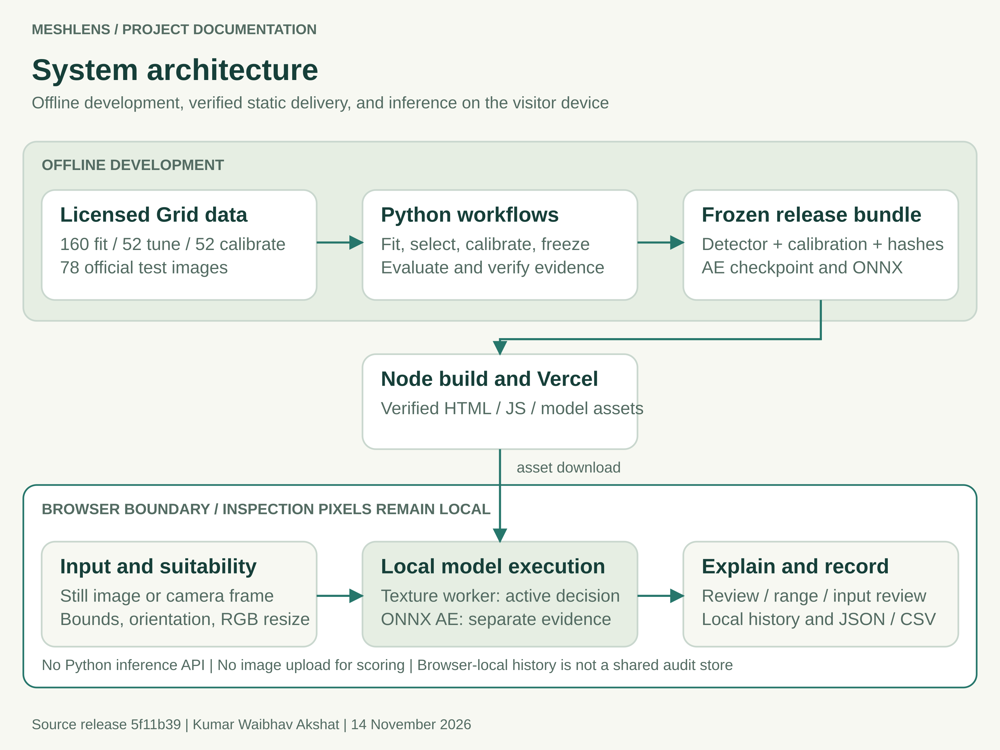

The browser receives static assets. Inspection pixels remain on the visitor device.

The host serves the interface, metadata, model files, JavaScript and WebAssembly assets. It does not provide a Python inference API. The browser validates the release, decodes a local source image, runs inference and displays evidence. An offline Python interface uses the same active detector contract.

Browser-local execution reduces hosting requirements and avoids sending inspection images to a scoring server. It transfers performance and memory constraints to the client device. Local history is convenient for export but is not a shared authenticated industrial audit store.

Source map: web/app.js manages the workflow; web/detector.js and web/texture_worker.js manage the active worker; src/meshlens/inspection.py validates the offline bundle. Numerical implementations and input code are pinned in the freeze record.

## 04 Dataset and source controls

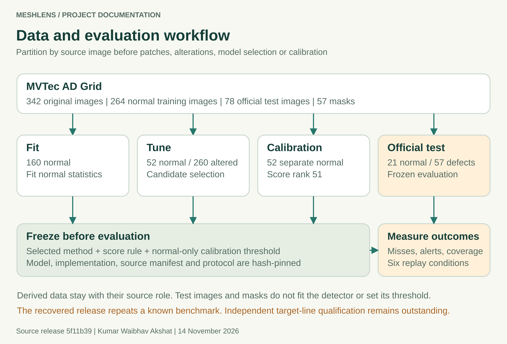

Source-image roles remain separate through development, calibration and evaluation.

MVTec AD Grid contains 342 original photographs and 57 defect masks. Its 264 normal training sources become 160 fit, 52 tune and 52 calibration images. The official test contains 21 normal and 57 defective images. Bent and broken groups each have 12 defects; glue, metal contamination and thread each have 11.

All 401 raw files are tracked: the photographs, masks and two source text files. The acquisition pins a public mirror revision and archive digest. The audit verifies that mirror acquisition; it does not claim an independent byte comparison with an official download. Data retain CC BY-NC-SA 4.0 terms.

Use data/manifest.csv, data/mask_checksums.json and data/provenance.json for exact paths, roles and digests. The source image, rather than a derived patch or crop, is the partition unit.

## 05 Development and leakage controls

Fitting, method selection, threshold calibration and final measurement answer different questions. MeshLens separates them so that a strong-looking test result cannot justify changing the model or cutoff after seeing a release failure. Patches and synthetic alterations inherit the role of their source image.

| Stage | Evidence and permitted use |
|---|---|
| Fit | 160 normal sources fit the normal reference. The historical AE also trains only from normal development data. |
| Tune | 52 unchanged normal images plus 260 seeded alterations compare candidates. Alteration families are bend, gap, fibre, glue and contamination. |
| Select | The texture comparison retains 15 variant and aggregation configurations. The selected joint configuration records 72.31% synthetic macro recall at 2/52 clean tune alerts. |
| Calibrate | 52 separate normal images supply the frozen operating limit after the method and score rule are selected. |
| Evaluate | All 78 official test sources are scored after freeze, including explicit inconclusive outcomes. Labels and masks do not fit the active detector or threshold. |

### What the recovered evidence can establish

The current release recovers the previously selected detector and repeats a benchmark whose outcomes were already known. Its architecture, score and threshold were not retuned during recovery. The results establish reproducibility on that known benchmark. They do not create an unseen holdout or an independent factory cohort.

Synthetic development recall is a selection proxy, not real-defect test accuracy. For a new target process, collect and independently label separate physical parts or sections. Keep repeated frames and crops in the same group. Preserve an untouched evaluation cohort for any subsequently changed release.

References: reports/inspection/selection.json, reports/inspection/protocol.json, reports/texture/ and docs/FIELD_VALIDATION.md.

## 06 Active detector and model responsibilities

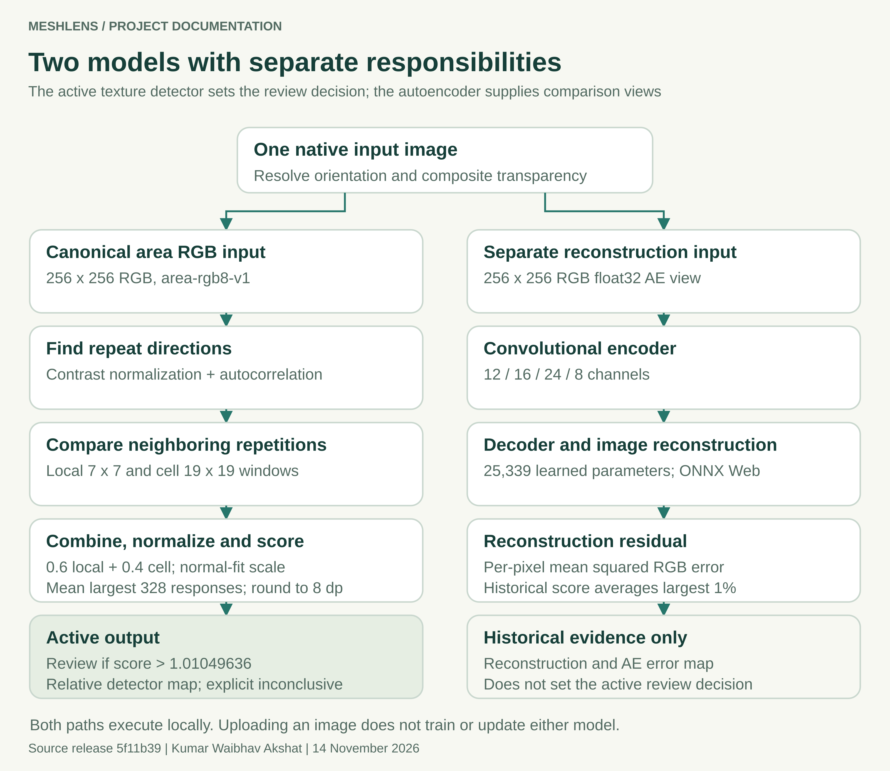

The active score and historical reconstruction follow separate processing and decision paths.

The active normal-lattice-v1 method uses the joint variant and no pretrained neural weights. Its 1,261-byte JSON artifact stores normal-fit and scoring parameters. Opening the page or choosing an image does not train either model. The relative detector map is neither a defect probability nor a validated segmentation boundary.

## 07 Historical autoencoder experiment

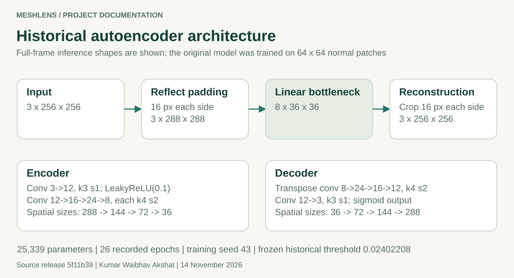

The full-frame inference shape includes reflection padding and final cropping. Training uses smaller normal patches.

| Property | Recorded configuration |
|---|---|
| Architecture | Convolutional denoising AE; 25,339 parameters; eight-channel bottleneck |
| Training | 26 recorded epochs; selected best epoch 26; seed 43; Gaussian input noise 0.035 |
| Hidden and output activations | LeakyReLU 0.1; linear bottleneck; sigmoid reconstruction |
| Historical score | Average the largest 1% of per-pixel mean squared RGB reconstruction errors |
| Historical outcome | 11/57 defects flagged, 46 missed; 0/21 normal false alarms at its own cutoff |

The weak recall showed that this frozen reconstruction experiment was unsuitable as the main inspection decision. A reconstruction residual is not guaranteed to separate a defect from normal texture variation. The record does not contain controlled ablations that isolate the contribution of capacity, training, resizing and score aggregation to every miss.

The AE remains useful for teaching reconstruction and comparing evidence. Its original model card, notebook and technical_report.pdf are retained as historical material and must not be read as the active detector specification.

## 08 Preprocessing scoring and calibration

### Canonical input

Still PNG, JPEG and WebP containers are limited to 12 MiB, 4,096 pixels per side and 16 megapixels. The active detector additionally requires at least 256 pixels on each side and an aspect ratio no greater than 1.5. Orientation is resolved, alpha is composited over white and the whole suitable image is area-resized to 256 by 256 RGB. Unsuitable framing is not silently cropped.

### Pattern disagreement

The algorithm converts RGB to channel-mean grayscale, normalizes local contrast and estimates independent repeat directions through autocorrelation. It compares neighboring repetitions with small alignment tolerance at radii 3 and 9. At least two usable lattice directions are required. The joint map combines median-normalized local and cell responses, then divides by the normal-fit scale.

```text
joint = 0.6 * local_normalized + 0.4 * cell_normalized
response = joint / 0.47045176621031776
k = ceil(256 * 256 * 0.005) = 328
score = round_half_up(mean(largest_k(response)), 8)
review = score > 1.01049636
```

### Separate calibration

The 52 normal calibration scores are sorted after method selection. Rank ceil((52 + 1) x 0.95) = 51 sets the threshold. Exact equality remains within range. The calibration-tail interpretation assumes exchangeability; it cannot guarantee the false-alarm rate after lighting, material or viewpoint changes.

Python and JavaScript use the same canonical filter when supplied identical decoded pixels. Native browser and Pillow codec decoding remain a separate boundary. A SHA256 digest detects changed bytes; it is not an author signature.

## 09 Benchmark performance

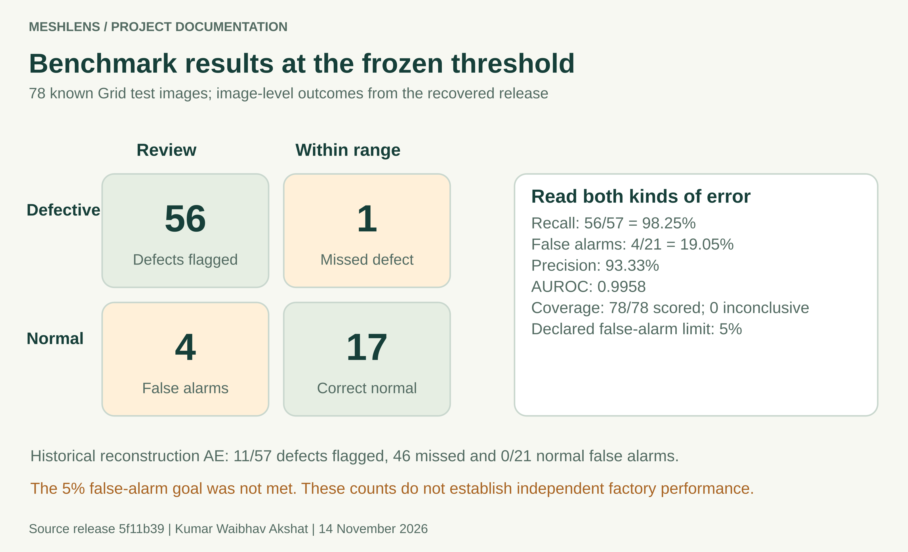

Image-level confusion counts at the active frozen operating point.

| Defect family | Flagged | Missed |
|---|---|---|
| Bent | 12 | 0 |
| Broken | 12 | 0 |
| Glue | 10 | 1 |
| Metal Contamination | 11 | 0 |
| Thread | 11 | 0 |

The known glue-008 defect scores 0.97635626, below the 1.01049636 limit. Its gallery inclusion makes an actual miss visible. The gallery is selected from already evaluated cases and is not an independent validation collection.

## 10 Stress tests and uncertainty

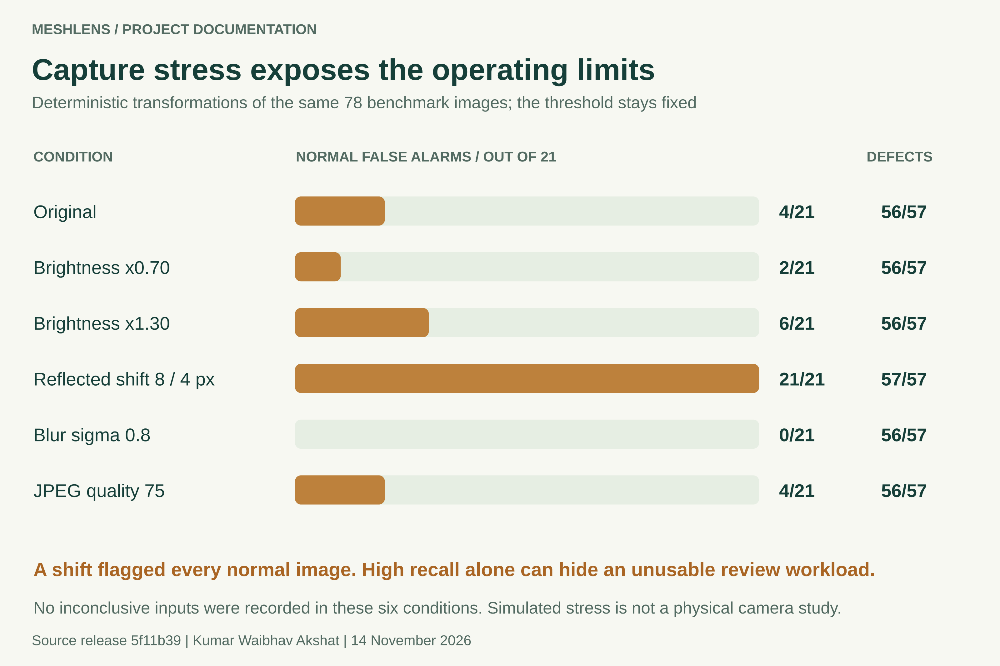

Fixed-threshold results under six declared replay conditions. No new physical parts are added.

The original-condition recall is 56/57, with Wilson 95% bounds of 90.71% to 99.69%. The normal false-alarm rate is 4/21, with bounds of 7.67% to 40.00%. These wide intervals reflect the small sample sizes. A strong AUROC of 0.9958 does not remove the cost of the chosen operating point.

The release goal required at least 90% recall and no more than 5% normal false alarms. The original false-alarm rate exceeds that limit. Reflected translation flags every normal test image, exposing sensitivity that prevents automated line acceptance. All 468 image-condition records produced scores; none was inconclusive in this defined stress suite.

## 11 Inspection lifecycle and result states

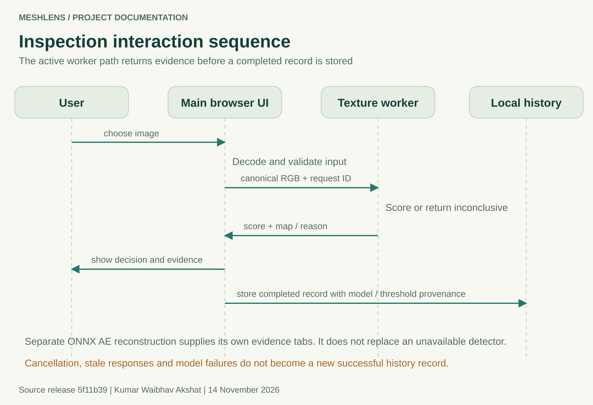

Main active-worker sequence. The separate AE evidence path does not supply a fallback decision.

| State | Expected behavior |
|---|---|
| Loading or unavailable | Explain readiness or retry. Block a numeric result from an unverified model. |
| Running | Keep one inference in flight. New input or cancellation invalidates stale work. |
| Scored | Display score, frozen threshold, decision, model provenance and evidence. |
| Inconclusive or failed | Explain the cause. Do not turn failure into a normal acceptance or successful history record. |

Camera access follows user action and browser permission. Sampling is serial and waits after each frame; it does not claim video-rate inspection. Camera stop, page hiding, ended tracks and failed inference require resource cleanup.

## 12 Interface overview and first use

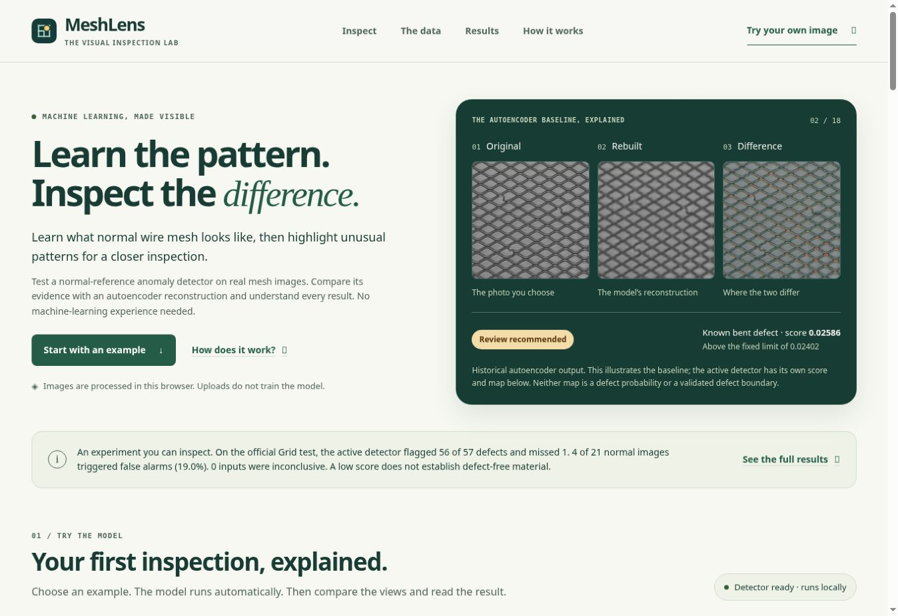

Actual public MeshLens desktop interface captured on 14 November 2026. The hero explicitly labels its historical AE illustration.

A new visitor should be able to explain the task before trying the model. The revised page introduces the material, identifies local inference, shows an original/rebuilt/difference example and provides a direct route to inspection. The project-scope statement places measured limitations before the main task.

- Open the public demo and wait for Detector ready.
- Try a guided benchmark image and reveal its label after inference.
- Compare all four evidence views and read the result against the fixed limit.
- Export a record or bring a suitable new photograph.

The first interface looked empty and did not explain the dataset or the next action. This was owner feedback, not a quantified recruited-user study. The revised onboarding addresses that feedback, while comprehension still benefits from testing with first-time users.

## 13 Inspection workspace and evidence views

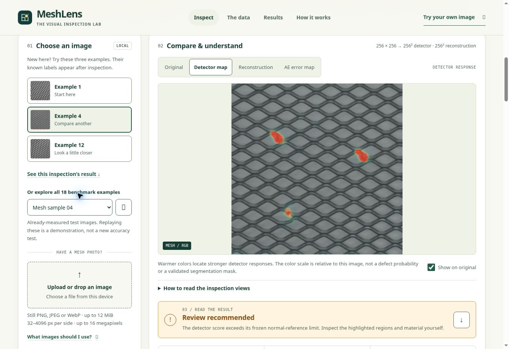

Actual completed inspection of a bent-wire benchmark example. The relative detector response and review state are visible.

| View | Interpretation |
|---|---|
| Original | The active detector input after its canonical RGB area resize. |
| Detector map | Relative disagreement used by the active texture method. Color is not a defect probability. |
| Reconstruction | The historical AE rebuilds a separate 256 by 256 input. |
| AE error map | Reconstruction residual of that separate baseline, not the active score. |

Known benchmark labels appear after inference and do not enter model feeds. History holds up to 100 records in the browser, without saving image pixels. JSON and CSV exports preserve numerical provenance; CSV escaping also addresses untrusted filenames.

## 14 Dataset and measured results screens

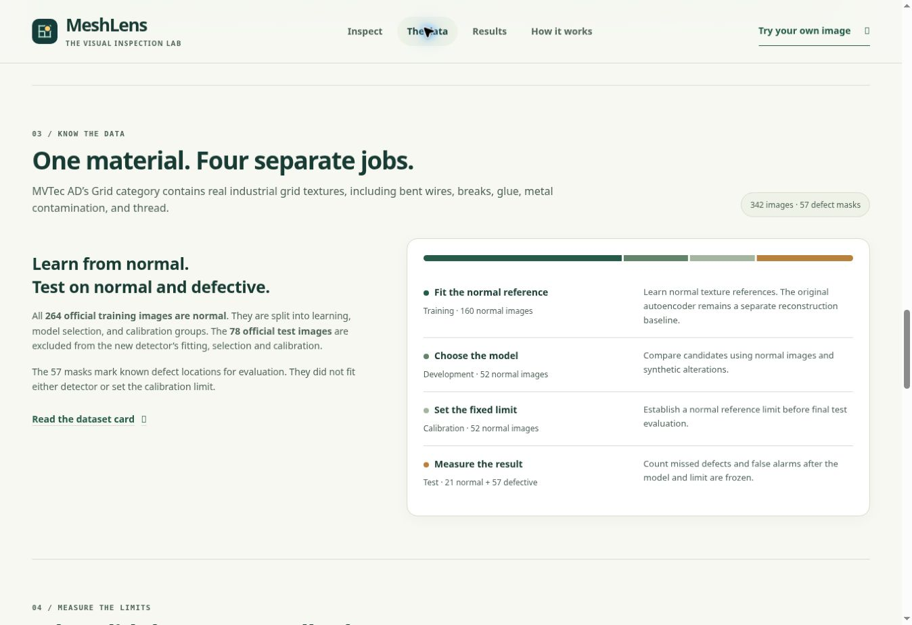

Actual dataset view explains the four source roles and the meaning of the masks.

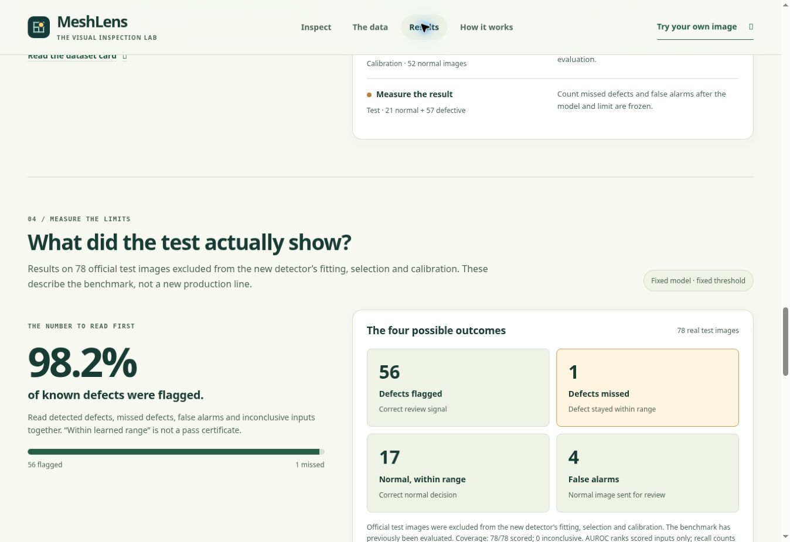

Actual results view displays detected defects, missed defects, correct normal decisions and false alarms.

Screenshots document the current desktop workflow. They are not independent accuracy measurements or evidence that every device and assistive technology was tested.

## 15 Responsive design and accessibility scope

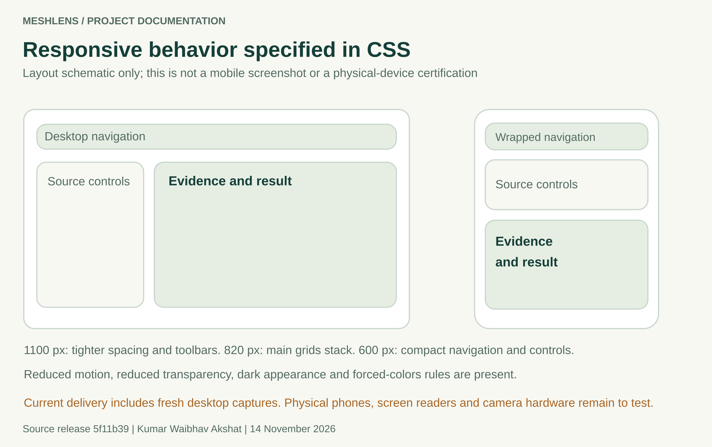

Documented responsive rules illustrated schematically. This figure is deliberately labeled as a schematic, not a phone capture.

| CSS condition | Declared layout behavior |
|---|---|
| Up to 1100 px | Tighter spacing, compact toolbars and a narrower source column. |
| Up to 820 px | Hero, inspection, dataset, results and method grids stack. |
| Up to 600 px | Navigation wraps, controls compact, score rows reflow and tables scroll locally. |
| User preferences | Dark appearance, reduced motion, reduced transparency and forced-colors rules. |

The prior accessibility record includes contrast, keyboard and automated layout checks on an earlier UI revision. The later four-tab detector workflow needs its own complete review. The 44-pixel core target is a design target; WCAG 2.1 target-size criterion 2.5.5 is AAA. Fresh desktop captures are included here; a fresh mobile capture, physical phones, screen readers and camera hardware were not tested for this report.

## 16 Offline interface and operating commands

The active offline route needs Python 3.12 with NumPy and Pillow. It is separate from the heavier historical training environment. A scored result contains a score and a strict-threshold decision. An inconclusive result contains an actionable reason; a missing model must not silently fall back to the AE.

```text
py -3.12 -m venv .venv-inspection
.\.venv-inspection\Scripts\python.exe -m pip install -r requirements-inspection.lock
.\.venv-inspection\Scripts\python.exe -m pip install --no-deps -e .
.\.venv-inspection\Scripts\python.exe scripts/inspect_image.py "C:\mesh.png" --evidence inspection-output/run-1
```

| Interface | Contract |
|---|---|
| Result status | scored or inconclusive; inconclusive inputs have no acceptance decision. |
| Scored fields | score, threshold, is_anomaly, decision, model_version and provenance digests. |
| Evidence directory | New directory containing result.json, canonical-input.png and relative-anomaly-map.png when scored. |
| CLI exit | 0 for scored; 1 for inconclusive; 2 for invalid arguments or output write failure. |
| Output protection | Existing outputs, source/data/artifact paths and input overwrite are rejected. |

Use a new evidence directory for each inspection. If port 4173 is occupied, use the documented programmatic startServer({port:0}) command and open its printed address. The server entrypoint does not parse a --port flag. Full command details and Linux equivalents are in PROJECT_DOCUMENTATION.md and RUNBOOK.md.

## 17 Deployment and release controls

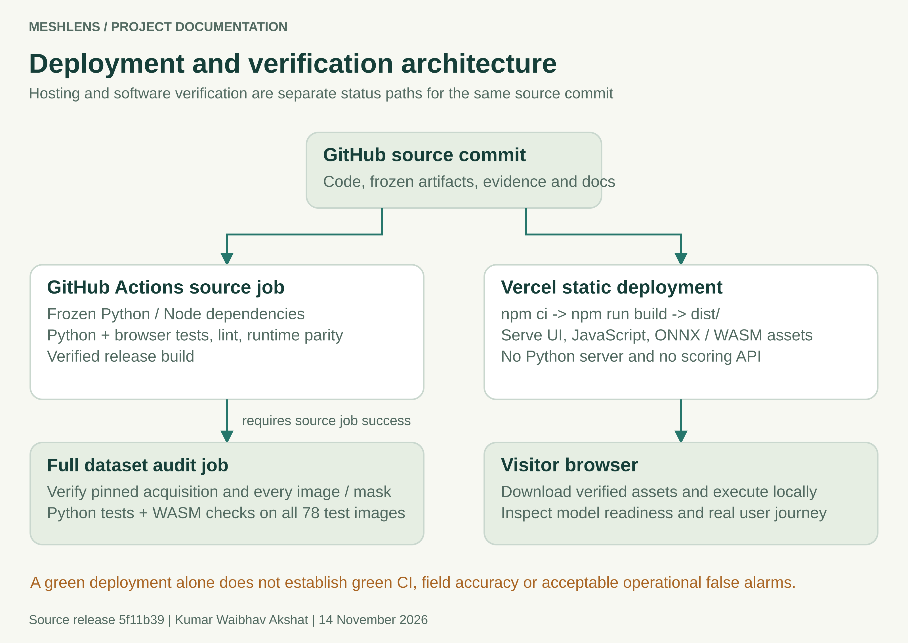

Source verification and deployment must both be assessed against the same commit.

| Reference release evidence | Observed status |
|---|---|
| Source commit | 5f11b39fbd989e2b4f6359dc75cda062daf8b9ba |
| GitHub run 43376785899 | Source/frozen-model and full research-data jobs passed. |
| Vercel commit status | Success for the reference commit. |
| Public application | https://mesh-lens.vercel.app/ |

These statuses were rechecked on 14 November 2026. A subsequent documentation commit needs a new run. Validate model readiness, the displayed version and a real inspection after deployment; a successfully uploaded site alone does not establish data integrity or target-line performance.

## 18 Verification and security evidence

After the CI repair, local verification passed 215 Python tests and 143 browser tests. The timeout integration passed 12 consecutive repetitions. The corresponding hosted source and full-data jobs passed. The committed verification.json is an earlier 211-test snapshot; its date and source digests are retained rather than relabeled as the later CI artifact.

| Evidence | Scope and limitation |
|---|---|
| Runtime parity | 78 official inputs and 18 gallery replays agree on canonical pixels, rounded scores and decisions between Python and shipped JavaScript under Node. Native decoder behavior remains separate. |
| Software regressions | Input bounds, artifact tampering, tensor contracts, stale work, worker/camera cleanup, replay/history recovery, build replacement and local server behavior. |
| 13 November dependency review | Browser packages, two active Python dependencies and 61 development additions reported no known findings in those queries. |
| Training query limitation | The 36-package training scope skipped Torch 2.14.1+cpu because that distribution could not be matched by the query. It is not counted as audited. |
| 31 October historical scan | The original training environment had five recorded Torch advisory findings. That is a different dated environment. |

The documentation work does not introduce a new penetration test or establish the absence of unknown vulnerabilities. Report audit date, packages, skipped components and unresolved findings. SHA256 release consistency checks complement bounded inputs and safe output handling but are not a complete supply-chain trust system.

References: reports/inspection/security-review.json, reports/security-audit-summary.json, tests/, .github/workflows/ci.yml and the model runtime-parity reports.

## 19 Delivery and environment incidents

These incidents affected the ability to receive, run and understand the project. Their corrective actions should become default delivery checks for future work.

| Observed problem | Established cause or scope | Corrective action |
|---|---|---|
| Shared ZIP failed to download | Recipient could not use the selected sharing route; the backend cause was not established. | Supply a directly downloadable artifact and verify the recipient route. |
| Archive destination failed | The proposed Documents destination was unavailable; a later command entered a nonexistent path. | Use the already extracted folder and inspect its real files before proposing commands. |
| Updater rejected .git | The selected path was the update package or outer folder, rather than the existing repository. | Validate project root, repository, remote and branch before mutation. |
| Large Git transfer | Data/model history produced a transfer around 168 MiB; bandwidth also affected elapsed time. | Keep lightweight update packages and evaluate external acquisition or release assets early. |
| Port 4173 occupied | Another process owned the default port. | Choose a documented free port; do not stop an unidentified process. |
| Ownership confusion | Author metadata, active login, pushing credentials and historical contributor attribution are separate. | Check the authenticated account, expected remote and author. Preserve history and third-party rights. |

A delivery is only reviewable when another person can download it, locate the correct folder, run it and interpret the first result. A compressed archive and a list of assumed paths are insufficient. The full incident record is in LESSONS_LEARNED.md.

## 20 Model UX and verification incidents

| Observed problem | Correction or remaining work |
|---|---|
| AE flagged only 11 of 57 defects | A specialized texture detector became the active decision. Keep the weak baseline and its failure counts visible. |
| False alarms and shift sensitivity | The active detector still flags 4/21 normal originals and 21/21 shifted normals. Qualification remains open. |
| Unclear first screen | Added guided examples, source roles, new-photo instructions, visible limits and explanation views. User comprehension still requires direct observation. |
| Line-ending hash mismatch | Preserve frozen CSV bytes and force ordinary text to LF in .gitattributes. Test a fresh cross-platform checkout. |
| Interrupted or stale verification evidence | Write a current failed/pending report before execution, validate JUnit and replace reports atomically. |
| Hosting green while CI red | Check independent statuses for the exact commit; retrieve the failed assertion before changing code. |
| Process cleanup race | Replace check-then-read existence assertions with bounded Linux-state polling. Accept disappearance while still rejecting a running child. |

### The confirmed CI failure

Run 43371910619 had 210 passing Python tests, one failing timeout regression and 143 passing browser tests. Linux removed a stopped child between os.kill(pid, 0) and stat.exists(). The missing /proc entry represented completed cleanup, but the test rejected it.

The repair handles both FileNotFoundError and ProcessLookupError, recognizes stopped states and allows a bounded termination interval. Four deterministic regressions preserve these cases. Node action-runtime and Ubuntu-image notices were maintenance warnings; the detailed failure log established the actual cause.

The correction fixes that CI race. It does not improve model accuracy or qualify the inspection process.

## 21 Operational risks and field qualification

The strongest remaining risk is an appealing demonstration being interpreted as a qualified inspection system. The original benchmark missed one defect, produced normal false alarms above the declared limit and failed the defined translation stress. A score inside the normal reference is not a defect-free certificate.

| Risk | Required evidence or control |
|---|---|
| Material and capture shift | Collect representative new parts across the intended material, optics, lighting, alignment, focus and nuisance conditions. |
| Dependent observations | Group repeated frames, views and crops by physical part or section; count independent parts explicitly. |
| Error cost and review workload | Agree the acceptable miss rate, normal review demand, coverage, latency and operator burden before evaluation. |
| Statistical uncertainty | Report support counts and confidence bounds; do not let high AUROC conceal unacceptable fixed-threshold errors. |
| Operational ownership | Specify review responsibility, version provenance, escalation, monitoring, rollback and requalification triggers. |
| Rights and data use | Confirm permission and commercial data rights. The MIT code license does not override benchmark restrictions. |

The field workflow in docs/FIELD_VALIDATION.md records a cohort, independently checked labels, grouping, frozen model/threshold, failures and acceptance limits. It is a procedure to be performed, not evidence that a factory study has been completed.

Any changed architecture, cutoff or capture process needs an appropriate new evaluation. Prefer a restricted, defensible scope to an unsupported claim of universal or production-grade accuracy.

## 22 Staggered plan for the next project

Use the following stages to prevent a conventional premise or weak model from accumulating a large delivery effort around it. Parallel work is useful after contracts and evidence boundaries are clear. Each stage has a decision to continue, narrow the scope or stop.

| Stage | Evidence required to proceed |
|---|---|
| 1 Problem discovery | A real intended user, a repeated task, an observed baseline and a measurable potential benefit. |
| 2 Novelty and feasibility | Comparison with existing solutions, a specific gap and a feasible data/deployment path. |
| 3 Data and acceptance | Lawful representative data, credible labels, entity grouping, independent roles and predeclared operating criteria. |
| 4 Baselines and experiments | A reproducible simple baseline and justified alternatives that improve a useful task metric. |
| 5 Frozen evaluation | A pinned candidate and untouched holdout with error counts, coverage, uncertainty and nuisance-condition results. |
| 6 Product workflow | Users can complete and explain the task; error, accessibility and representative-device checks are recorded. |
| 7 Reliable delivery | Fresh-install reproduction, passing required CI, dated security findings and observed deployment for the same commit. |
| 8 Handoff and operation | Complete documentation, ownership, monitoring, rollback and conditions requiring new evaluation. |

Estimate value in the user's units: review time, rejected clean parts, missed defects, latency and operating cost. Do not invent throughput or savings. Compare the added complexity against the baseline workflow.

The next project topic has deliberately not been selected in this report. Use NEXT_PROJECT_PLAYBOOK.md to compare candidate problems before development begins.

## 23 Reproduction and documentation maintenance

### Run the delivered application

```text
git clone https://github.com/kumarwaibhav/MeshLens.git
cd MeshLens
npm ci
npm test
npm run build
npm run serve
```

Node.js 22 or newer is required. Use npm.cmd on Windows if its PowerShell shim is blocked. The verified build uses shipped artifacts and does not retrain the detector or download raw data. Python 3.12 is required for the separately documented inference and development workflows.

### Regenerate documentation assets

```text
python -m pip install -r docs/report/requirements-docs.lock
npm ci --prefix docs/report
python docs/report/build_assets.py
node docs/report/render_assets.mjs
python docs/report/build_report.py --pdf
```

The editable SVG figures derive benchmark values from the frozen evaluation. PNGs support Word/PDF rendering. The report builder writes a Word edition and PROJECT_REPORT.md; optional PDF conversion needs LibreOffice on PATH. Inspect rendered pages after edits. Keep screenshots as dated observations, and capture the UI again after material interface changes.

Regenerate models in a separate reproduction copy using the manual. Fitting and export can overwrite artifacts; changing evidence requires a new release record and suitable evaluation. Preserve hashes and filenames rather than editing expected values to make checks pass.

A documentation-only update should leave numerical code, model artifacts and the frozen evaluation unchanged. Its new GitHub Actions run still needs to complete before publication is declared verified.

## 24 Evidence index authorship and licenses

| Evidence | Primary location |
|---|---|
| Reference source and CI | Commit 5f11b39; GitHub Actions run 43376785899 |
| Active model and threshold | artifacts/inspection/detector.json and detector-model.json |
| Freeze and protocol | reports/inspection/frozen_configuration.json and protocol.json |
| Raw and packaged evaluation | reports/inspection/independent_evaluation.json and evaluation.json |
| Dataset provenance | data/manifest.csv, mask_checksums.json and provenance.json |
| Current dated dependency review | reports/inspection/security-review.json and linked scanner files |
| Historical UI review | docs/design/ and reports/ui-redesign-browser-scans.json |
| Fresh desktop UI captures | docs/assets/screenshots/; captured 14 November 2026 |
| Editable diagrams and report | docs/assets/diagrams/ and docs/report/ |
| Technical and learning guides | PROJECT_DOCUMENTATION.md, LESSONS_LEARNED.md and NEXT_PROJECT_PLAYBOOK.md |

Original MeshLens code and documentation are authored by Kumar Waibhav Akshat under the repository MIT license. MVTec Software GmbH and the original authors retain rights in the photographs, masks and dataset-derived material under CC BY-NC-SA 4.0. Preserve the dataset license and THIRD_PARTY_NOTICES.md when distributing the project.

Primary external references are the official MVTec AD dataset page, its linked license, the repository source and the successful hosted CI run. This report separates recorded results, interpretation and recommended future work. It makes no independent factory-qualification, universal accessibility or vulnerability-free guarantee.

Repository: https://github.com/kumarwaibhav/MeshLens
Demo: https://mesh-lens.vercel.app/
Dataset: https://www.mvtec.com/research-teaching/datasets/mvtec-ad
License: https://creativecommons.org/licenses/by-nc-sa/4.0/
CI: https://github.com/kumarwaibhav/MeshLens/actions/runs/43376785899
